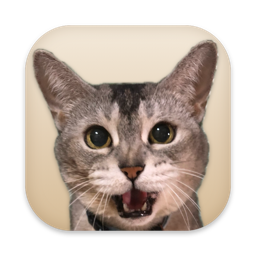
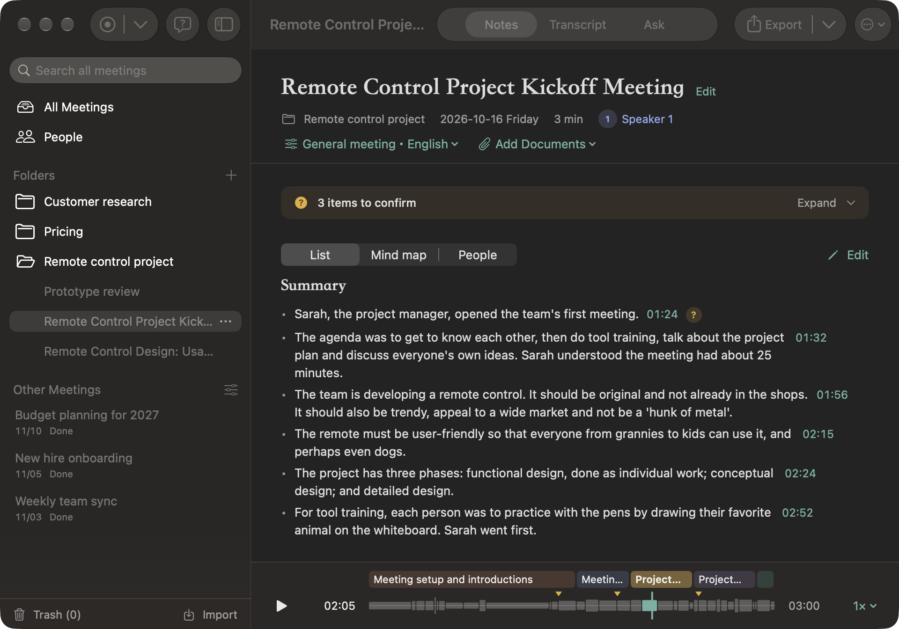
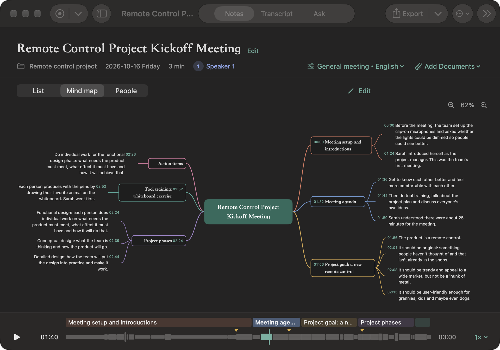
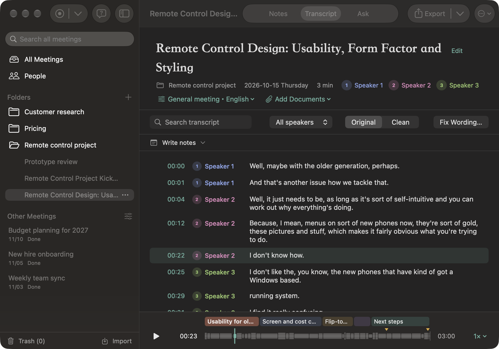

[繁體中文](../README.md) | **English**

# Meeting Assistant (MA)

A meeting-notes app for macOS. Record a meeting (in person or online) and watch a live transcript as it happens. Afterwards Meeting Assistant transcribes the recording on your Mac, identifies the speakers, and has Claude, Codex or an API write the meeting notes. Every item in the notes carries a timestamp: click it to hear what was actually said.

- By default, recording, transcription and speaker identification run locally and recordings are not uploaded (exception: if you sign in to your company's enterprise server and choose server transcription, recordings are sent to that server; see "Data and privacy")
- No Python, Homebrew or ffmpeg to install: download the DMG and go
- Interface in English, Traditional Chinese and Simplified Chinese (follows your macOS language); meetings can be in English, Chinese, Japanese, Cantonese or Korean (experimental)
- Requires Apple Silicon and macOS 26

Meeting Assistant is a fork of [Shiyin 拾音](https://github.com/juinwei7/Shiyin), an MIT-licensed open-source project (see "License" below).



## How it works

1. **Record or import**: click Record in the toolbar (⌘R). For online meetings choose "Microphone + Computer Audio" so the other side is recorded too. Already have a recording? Drag it into the window.
2. **Watch and take notes while recording**: the live transcript is on the left; in My Notes on the right, every new line is stamped with the recording time. Press Mark Highlight (⌘B) at important moments. You can tag who is speaking right on the recording screen, mute your microphone when you don't want to be recorded, and press ⌃⌥⌘S to capture a shared screen.
3. **Stop and transcribe**: a draft is written from the live transcript right away, while the recording is transcribed locally and split by speaker. Rename "Speaker 1" to a real name and Meeting Assistant remembers the voice for future meetings.
4. **Read the notes**: summary, decisions, action items and open questions, each with a timestamp. Uncertain names and terms become questions to confirm; your answers are applied to the notes. Ask anything about the meeting in the Ask tab.
5. **Export or share**: notes as Markdown, PDF or Word, the mind map as an image, the transcript as subtitles, or the whole meeting as a .shiyin package.

## Features

- **Recording**: microphone only, microphone + computer audio (Zoom, Meet, Teams), or computer audio only; live transcript, levels, pause, highlights, notes; input alerts; reconnects when you switch headphones; reminds you to record when an online meeting starts; recovers recordings after a crash. ⌃⌥⌘R starts or stops recording and ⌃⌥⌘B marks a highlight from any app
- **Tag speakers while recording**: tap a name on the recording screen to mark who is talking; after recording the tags are matched to the identified speakers, and skipped when they don't match or conflict
- **Mute the microphone while recording**: when recording an online meeting with microphone + computer audio, press ⌃⌥⌘M or the microphone icon on the recording screen; muted stretches of the microphone aren't recorded, with a reminder if you forget to unmute
- **Recording island**: the small window at the top of the screen while recording; keep it on the built-in display, the display with the main window, or follow the display you're using
- **Screens during meetings**: while recording, press ⌃⌥⌘S (or Screenshot on the recording island or the recording screen) to capture what's shared on screen, or paste or drag in photos; each screen is tied to its moment in the recording, shows up in the transcript, and the text on it is searchable. Meeting notes use what's on the screens (notes tools that can see images get the images too), and exported notes, transcripts and .shiyin packages include them. The first screenshot asks for macOS Screen Recording permission
- **Stop timer**: next to the recording clock, choose 30 minutes to 3 hours from now, or a specific time, and recording stops and transcribes on its own; a 30-second countdown comes first, and Keep Recording carries on
- **Local transcription**: whisper.cpp + Breeze ASR 25 (MediaTek), or optionally Qwen3-ASR 1.7B or macOS speech recognition; Japanese and Korean meetings use Whisper large-v3-turbo, Cantonese uses Qwen3-ASR. Long recordings are transcribed in chunks, so even 4-hour meetings stay within memory
- **Meeting language**: Chinese, English, Japanese, Cantonese or Korean per meeting, detected automatically after recording starts
- **Speakers and voice matching**: each transcript segment is labeled with a speaker; once you name someone, their voice is recognized in later meetings, with the reason shown (how similar, who came second). Naming a speaker whose voice doesn't match that person asks first; the People page lists each person's voice samples, flags samples to check, and lets you delete one. After transcribing again, names follow the voices, and names that no longer match become questions to confirm
- **Meeting notes**: templates for general meetings, 1:1s, interviews, lectures and brainstorms, or your own; Claude Code, Codex CLI, Anthropic API, OpenAI API, Gemini API, OpenAI-compatible APIs (including local Ollama and LM Studio), or no notes. Edit and undo; mind map; topic timeline; add reference documents (PDF, Word, PowerPoint, images)
- **Notes list view**: copy each section on its own (for Slack or email), topic bands split by the time of each point, a table of contents when there are many topics
- **Export and share**: notes (Markdown, PDF, Word), mind map (PNG, PDF, SVG), transcript (txt, Markdown, srt, vtt, Word), audio (m4a, wav), whole-meeting package (.shiyin)
- **Ask your meetings**: ask one meeting or all of them in plain language; answers link to the recording time
- **Let AI tools read your meetings (MCP)**: add to Claude Code, Codex or Claude Desktop in one click; read-only
- **Organize**: folders, full-text search, trash (restorable for 30 days), scheduled database backups
- **More**: playback speed, term corrections, automatic m4a compression, notifications, in-app updates, Help → Report a Problem…





<sub>The demo recording in the transcript screenshot is from the [AMI Meeting Corpus](https://groups.inf.ed.ac.uk/ami/corpus/) (ES2004a, CC BY 4.0).</sub>

## System requirements

| Item | Requirement |
|---|---|
| Chip | Apple Silicon (M1 or later) |
| System | macOS 26 or later |
| Memory | 8 GB or more (transcription plus speaker identification peaks at about 2.9 GB) |
| Disk space | About 1.7 GB for the transcription model (downloaded on first use; not needed with macOS speech recognition), plus 574 MB for Japanese and Korean meetings, 60 MB for language detection, about 2.5 GB for Qwen3-ASR or Cantonese meetings, and your recordings (m4a, about 10–30 MB per hour) |
| Notes tool | One of: a signed-in [Claude Code](https://claude.com/claude-code), Codex CLI, an Anthropic / OpenAI / Gemini API key, or an OpenAI-compatible API. Or choose "No notes" |
| Network | Needed to download models and write notes; recording, local transcription and speaker identification work offline |

## Install

1. Download `Shiyin-<version>.dmg` from this repo's [Releases](https://github.com/EdenQ/Shiyin/releases), open it and drag Meeting Assistant to Applications.
2. Meeting Assistant isn't notarized by Apple, so macOS blocks it the first time: click Done (not Move to Trash), then go to System Settings → Privacy & Security and click Open Anyway (once). "Install Guide.pdf" in the DMG has the full steps.
3. The first launch walks you through microphone access, downloading the transcription model and choosing a notes tool. Every step can be skipped and done later in Settings.
4. When a new version is out, Meeting Assistant asks you and updates itself (from the latest Release of this repo).

### Build from source

Requires Xcode 26 (Swift 6.2 or later). The first build downloads GRDB, FluidAudio and the whisper.cpp XCFramework with Swift Package Manager.

```bash
git clone https://github.com/EdenQ/Shiyin.git
cd Shiyin
scripts/make-signing-cert.sh --trust   # once: create and trust a self-signed certificate (asks for your login password) so permissions survive updates
scripts/build-app.sh --install         # build the release app and install it to ~/Applications/Meeting Assistant.app
```

Without `make-signing-cert.sh --trust` the app is signed ad hoc, and macOS may ask for permissions again after each rebuild.

## Data and privacy

| Item | Where it goes |
|---|---|
| Recordings, transcripts, database, models | `~/Library/Application Support/Shiyin` (mode 700, not synced by iCloud); scheduled database backups in `backups/` in the same folder |
| Recording, transcription, speaker identification | By default (local Breeze, Qwen3-ASR or macOS speech recognition) entirely on your Mac, no network |
| Enterprise server (only if you sign in and choose the company server for transcription) | Recordings are sent to your company's own server for transcription and deleted afterwards; speaker identification and voice prints stay on this Mac. With the "Company" notes tool, transcripts are sent to the company server for notes. The sign-in token is kept in the Keychain |
| Notes, proofreading, Ask, speaker guesses | Transcript text, your notes, text read from reference documents and from meeting screens (notes tools that can see images also get the images), the glossary and basic meeting details go to the notes tool you chose (Claude, Codex, Anthropic, OpenAI, Google, the URL of an OpenAI-compatible API, or the company server); audio is not sent to notes tools. With a local OpenAI-compatible API (Ollama, LM Studio) the content stays on this Mac |
| AI tools reading meetings (only when turned on) | Meeting content you ask about in an AI tool is handled by that tool; read-only |
| Voice prints | Voice features (numbers, not audio) stay in the local database, are never uploaded or put in exported packages; you can view, delete or turn them off |
| Report a problem | Opens this repo's Issues in your browser only when you click "Report on GitHub"; you review and send it yourself, with no meeting content |
| Usage statistics | None |
| API keys | Stored in the macOS Keychain, never in files or logs |
| Local transcription, "No notes" (or local Ollama / LM Studio), no enterprise server | Recordings and meeting content never leave this Mac (downloading models and checking for updates still use the network) |

## Development

Specs come first, then code (SDD). Meeting Assistant's own requirements, design and tasks are in [`docs/fork/`](../docs/fork/); the other files under `docs/` are kept as in the original project.

```bash
scripts/build-app.sh               # release build (~/Library/Caches/ShiyinBuild/app/Meeting Assistant.app)
scripts/build-app.sh --debug       # DEBUG build with the test control channel (scripts/dev/shiyinctl.swift)
scripts/make-dmg.sh                # release build plus DMG and shiyin-update.json
scripts/dev/l10n.py check          # after changing UI text: list missing English and unlocalized Chinese
python3 scripts/fork/brand.py check-sources   # sources say "Shiyin"; the build renames it to Meeting Assistant (docs/fork/design.md §F7)
scripts/fork/check.sh              # the fork's regression checks
```

## Open-source projects and models

| Name | Used for | License |
|---|---|---|
| [Shiyin 拾音](https://github.com/juinwei7/Shiyin) | The original project Meeting Assistant is based on | MIT |
| [whisper.cpp](https://github.com/ggml-org/whisper.cpp) | Transcription, language detection | MIT |
| [Breeze ASR 25](https://huggingface.co/MediaTek-Research/Breeze-ASR-25) ([GGML](https://huggingface.co/shdennlin/breeze-asr-25-ggml)) | Transcription model (Traditional Chinese, mixed Chinese and English) | Apache-2.0 |
| [Whisper](https://github.com/openai/whisper) large-v3-turbo, base ([GGML](https://huggingface.co/ggerganov/whisper.cpp)) | Japanese and Korean transcription, language detection | MIT |
| [Qwen3-ASR 1.7B](https://huggingface.co/Qwen/Qwen3-ASR-1.7B) ([GGUF](https://huggingface.co/ggml-org/Qwen3-ASR-1.7B-GGUF)) | Optional transcription model, Cantonese (converted to Traditional Chinese with [OpenCC](https://github.com/BYVoid/OpenCC) dictionaries) | Apache-2.0 |
| [llama.cpp](https://github.com/ggml-org/llama.cpp) | Runs Qwen3-ASR | MIT |
| [FluidAudio](https://github.com/FluidInference/FluidAudio) | Speaker identification | Apache-2.0 |
| [GRDB.swift](https://github.com/groue/GRDB.swift) | SQLite database, full-text search | MIT |

Models are not in this repo; they are downloaded on first use. The app's About MA window and `Third-Party Licenses.txt` in the DMG include the full license terms of these projects.

## License

[MIT](../LICENSE). Meeting Assistant is based on [Shiyin 拾音](https://github.com/juinwei7/Shiyin) (MIT, Copyright (c) 2026 juinwei7); `LICENSE` is the original project's copyright and permission notice. The open-source projects and models above are under their own licenses.
