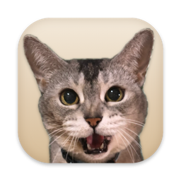
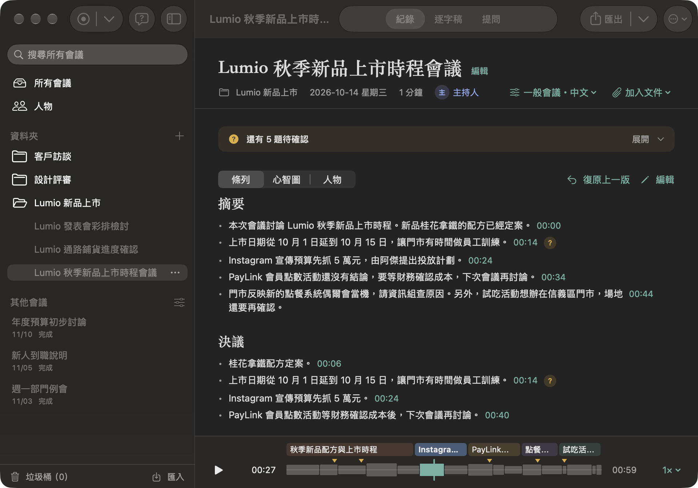
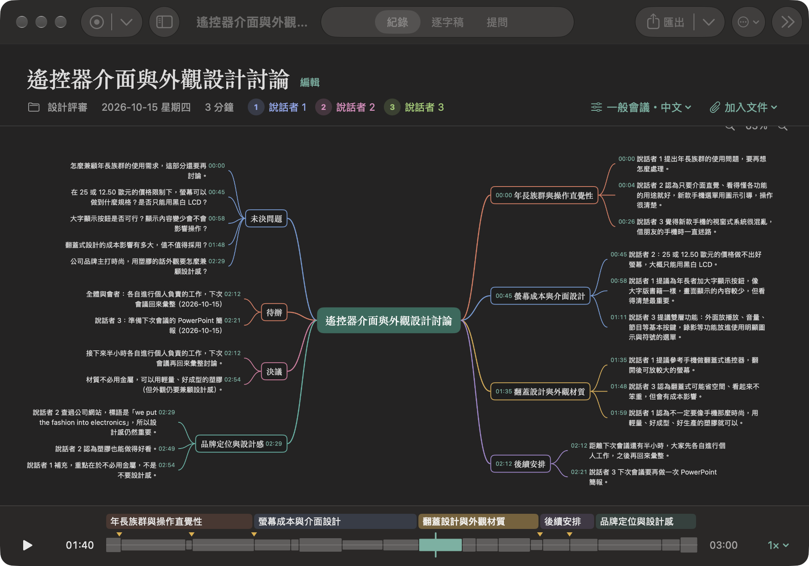
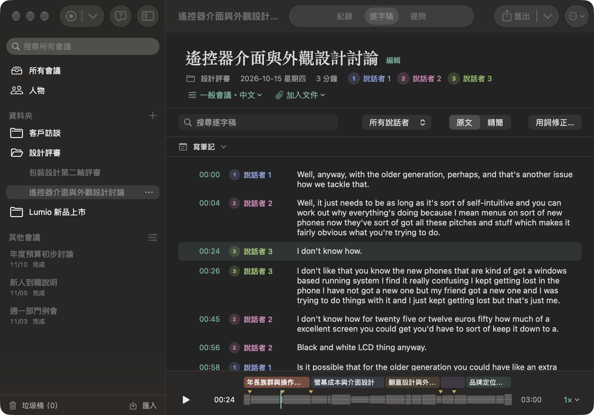

**繁體中文** | [English](.github/README.md)

# 會議助手（MA）

macOS 的會議紀錄 app。錄下會議（現場或線上），錄音中就能看到即時逐字稿；錄完在本機轉錄、分出說話者，再交給 Claude、Codex 或 API 整理成會議紀錄。紀錄裡每一條都附上錄音時間點，點一下就能聽到原話。

- 預設在本機錄音、轉錄、辨識說話者，錄音不會上傳（例外：自己登入公司的企業伺服器、選用伺服器轉錄時，錄音會送到公司的伺服器，見「資料與隱私」）
- 不需要安裝 Python、Homebrew 或 ffmpeg，下載 DMG 就能用
- 介面有繁體中文、簡體中文和英文（跟著 macOS 的語言），會議可以是中文、英文、日文、廣東話或韓文（韓文是實驗性的）
- 需要 Apple Silicon 和 macOS 26

會議助手是 MIT 授權的開源專案[拾音 Shiyin](https://github.com/juinwei7/Shiyin) 的 fork（見最後的「授權」）。



## 怎麼用

1. **錄音或匯入**：按工具列的「錄音」（⌘R）。線上會議請把錄音來源選「麥克風＋電腦聲音」，對方的聲音也會錄進來。已經有錄音檔的話，拖進視窗就好。
2. **邊錄邊看、邊記**：左邊是即時逐字稿，右邊「我的筆記」每換一行會自動記下錄音時間；重要的地方按「標記重點」（⌘B）。知道是誰在說話時，可以在錄音畫面直接標記說話者；不想被錄到時按麥克風靜音。
3. **停止並轉錄**：停止後馬上用即時逐字稿整理一份草稿，同時在本機正式轉錄並分出說話者。點「說話者 1」可以改成人名，會議助手會記住聲音，下次自動帶入。
4. **看會議紀錄**：轉錄完自動整理成摘要、決議、待辦、未決問題，每一條都能點時間點跳回錄音。不確定的人名和專有名詞會變成待確認的題目，回答後依答案修正。想知道誰說了什麼，可以在「提問」分頁直接問。
5. **匯出或分享**：會議紀錄存成 Markdown、PDF、Word，心智圖存成圖片，逐字稿存成字幕檔，或把整場會議打包成 .shiyin 傳給同事。

## 功能

- **錄音**：只錄麥克風、麥克風＋電腦聲音（Zoom、Meet、Teams）、只錄電腦聲音；即時逐字稿、音量、暫停、標記重點、筆記；收音提醒；換耳機自動接上；偵測到線上會議時提醒開始錄音；app 當掉後自動復原錄音。錄音中在任何 app 按 ⌃⌥⌘R 開始或停止、⌃⌥⌘B 標記重點
- **錄音中標記說話者**：錄音畫面點名字，標「現在是誰在說」；錄完依時間套到分出來的說話者，對不上或有矛盾就不套用
- **錄音中靜音麥克風**：用「麥克風＋電腦聲音」錄線上會議時，按 ⌃⌥⌘M 或錄音畫面的麥克風圖示，靜音的那段麥克風不錄；忘了打開時會提醒
- **錄音島**：錄音中螢幕上方的小視窗，可以選固定在內建螢幕、主視窗所在的螢幕，或跟著目前在用的螢幕
- **本機轉錄**：whisper.cpp + Breeze ASR 25（聯發科），可以改選 Qwen3-ASR 1.7B 或 macOS 內建辨識；日文、韓文會議用 Whisper large-v3-turbo，廣東話用 Qwen3-ASR。長錄音分段轉錄，4 小時的會議也不會吃掉太多記憶體
- **會議語言**：每場會議可以選中文、英文、日文、廣東話或韓文；開始錄音後自動偵測語言
- **說話者辨識與聲紋**：逐字稿每段標上說話者；取名後記住聲音，之後的會議自動帶入，並顯示依據（相似度多少、第二像的是誰）。取名時聲音跟這個人不像會先提醒；「人物」頁可以看每個人的每一份聲音特徵、找出要確認的樣本、單獨刪掉一份。重新轉錄後名字跟著聲音，對不上的改在待確認問
- **會議紀錄**：一般會議、一對一、訪談、課堂、腦力激盪等範本，也可以自訂；整理工具可選 Claude Code、Codex CLI、Anthropic API、OpenAI API、Gemini API、OpenAI 相容 API（含本機的 Ollama、LM Studio），或不整理。可以直接編輯、復原；心智圖；議題時間軸；加入參考文件（PDF、Word、PowerPoint、圖片）一起整理
- **紀錄條列頁**：每一段可以單獨複製（貼到 Slack、郵件）、議題帶依每條重點的時間切段、議題多時有目錄
- **匯出與分享**：會議紀錄（Markdown、PDF、Word）、心智圖（PNG、PDF、SVG）、逐字稿（txt、Markdown、srt、vtt、Word）、錄音（m4a、wav）、整場會議封包（.shiyin）
- **對會議提問**：用自然語言問一場或所有會議，回答附錄音時間點
- **讓 AI 工具讀取會議（MCP）**：一鍵加到 Claude Code、Codex 或 Claude Desktop，只能讀、不能改
- **管理**：資料夾、全文搜尋、垃圾桶（30 天內可還原）、定期備份資料庫
- **其他**：倍速播放、用詞修正、錄音自動壓縮成 m4a、通知、app 內更新、「輔助說明 → 回報問題…」





<sub>逐字稿截圖的示範錄音取自 [AMI Meeting Corpus](https://groups.inf.ed.ac.uk/ami/corpus/)（ES2004a，CC BY 4.0）。</sub>

## 系統需求

| 項目 | 需求 |
|---|---|
| 晶片 | Apple Silicon（M1 以上） |
| 系統 | macOS 26 以上 |
| 記憶體 | 8 GB 以上（轉錄加說話者辨識的峰值約 2.9 GB） |
| 磁碟空間 | 轉錄模型約 1.7 GB（第一次使用時下載；改用 macOS 內建辨識就不用），日文、韓文會議另外 574 MB、自動偵測語言 60 MB、Qwen3-ASR 或廣東話會議另外約 2.5 GB，加上錄音（m4a 約每小時 10～30 MB） |
| 整理工具 | 擇一：已登入的 [Claude Code](https://claude.com/claude-code)、Codex CLI、Anthropic／OpenAI／Gemini 的 API key，或 OpenAI 相容 API。也可以選「不整理」 |
| 網路 | 第一次下載模型、整理會議紀錄時需要；錄音、轉錄、說話者辨識都不需要 |

## 安裝

1. 到這個 repo 的 [Releases](https://github.com/EdenQ/Shiyin/releases) 下載 `Shiyin-<版本>.dmg`，打開後把「會議助手」拖到旁邊的 Applications（應用程式）。
2. 會議助手沒有經過 Apple 公證，第一次打開會被擋下：到「系統設定 → 隱私權與安全性」按「仍要打開」（只要做一次）。DMG 裡的「安裝說明.pdf」有完整步驟（英文版是「Install Guide.pdf」）。
3. 第一次打開會出現引導：允許麥克風、下載轉錄模型、選整理工具。每一步都可以略過，之後在設定裡補做。
4. 之後有新版時，會議助手會詢問你，同意後自動更新（讀這個 repo 最新的 Release）。

### 從原始碼建置

需要 Xcode 26（Swift 6.2 以上）。第一次建置會用 Swift Package Manager 下載 GRDB、FluidAudio 和 whisper.cpp 的 XCFramework。

```bash
git clone https://github.com/EdenQ/Shiyin.git
cd Shiyin
scripts/make-signing-cert.sh --trust   # 只要做一次：建立並信任自簽憑證（要輸入登入密碼），之後更新 app 時權限不用重新允許
scripts/build-app.sh --install         # 建置 release 版並安裝到 ~/Applications/Meeting Assistant.app
```

沒有執行 `make-signing-cert.sh --trust` 也能建置，會改用 ad-hoc 簽章，只是每次重新建置後系統可能會再問一次權限。

## 資料與隱私

| 項目 | 位置與去向 |
|---|---|
| 錄音、逐字稿、資料庫、模型 | `~/Library/Application Support/Shiyin`（權限 700，不會被 iCloud 同步）；資料庫定期備份在同一個資料夾的 `backups/` |
| 錄音、轉錄、說話者辨識 | 預設（本機的 Breeze、Qwen3-ASR 或 macOS 內建辨識）完全在本機，不連網 |
| 企業伺服器（自己登入、轉錄選「公司的伺服器」才有） | 錄音送到公司自己的伺服器轉錄，轉完就刪；說話者辨識和聲紋仍在這台 Mac。整理工具選「公司」時，逐字稿送到公司的伺服器整理。登入的 token 存在鑰匙圈 |
| 整理、校稿、提問、猜說話者 | 逐字稿文字、你的筆記、參考文件讀出來的文字、詞彙表、會議基本資料會送到你選的整理工具（Claude、Codex、Anthropic、OpenAI、Google、OpenAI 相容 API 填的網址，或公司的伺服器）；錄音檔不會送給整理工具。OpenAI 相容 API 填本機網址（Ollama、LM Studio）時內容不離開這台 Mac |
| 讓 AI 工具讀取會議（打開了才有） | 你在 AI 工具裡問到的會議內容會交給那個工具處理；只能讀、不能改 |
| 聲紋 | 說話者的聲音特徵（一組數字，不是錄音）只存在本機資料庫，不上傳、不放進匯出的封包；可以查看、刪除、關閉 |
| 回報問題 | 只在你按「在 GitHub 回報」時用瀏覽器打開這個 repo 的 Issues，內容你看過、自己送出，不含會議內容 |
| 使用統計 | 不送 |
| API key | 存在 macOS 鑰匙圈，不寫進檔案或 log |
| 本機轉錄、整理工具選「不整理」（或本機的 Ollama、LM Studio）、沒用企業伺服器 | 錄音和會議內容都不會離開這台 Mac（下載模型、檢查更新仍會連網） |

## 開發

先寫規格、再寫程式（SDD）。會議助手自己的需求、設計、任務在 [`docs/fork/`](docs/fork/)；`docs/` 底下其他文件照上游原樣。

```bash
scripts/build-app.sh               # release 建置（~/Library/Caches/ShiyinBuild/app/Meeting Assistant.app）
scripts/build-app.sh --debug       # DEBUG 建置，含驗證用的控制通道（scripts/dev/shiyinctl.swift）
scripts/make-dmg.sh                # release 建置並產生 DMG 和 shiyin-update.json
scripts/dev/l10n.py check          # 改過介面文字後：列出缺英文翻譯和沒查表的中文
python3 scripts/fork/brand.py check-sources   # 原始碼照上游寫「拾音」，建置時換成會議助手（docs/fork/design.md §F7）
scripts/fork/check.sh              # fork 的回歸檢查
```

## 使用的開源專案與模型

| 名稱 | 用途 | 授權 |
|---|---|---|
| [拾音 Shiyin](https://github.com/juinwei7/Shiyin) | 會議助手改寫的原始專案 | MIT |
| [whisper.cpp](https://github.com/ggml-org/whisper.cpp) | 正式轉錄、語言偵測 | MIT |
| [Breeze ASR 25](https://huggingface.co/MediaTek-Research/Breeze-ASR-25)（[GGML 轉檔](https://huggingface.co/shdennlin/breeze-asr-25-ggml)） | 轉錄模型（繁體中文、中英夾雜） | Apache-2.0 |
| [Whisper](https://github.com/openai/whisper) large-v3-turbo、base（[GGML 轉檔](https://huggingface.co/ggerganov/whisper.cpp)） | 日文、韓文轉錄、自動偵測語言 | MIT |
| [Qwen3-ASR 1.7B](https://huggingface.co/Qwen/Qwen3-ASR-1.7B)（[GGUF 轉檔](https://huggingface.co/ggml-org/Qwen3-ASR-1.7B-GGUF)） | 可選的轉錄模型、廣東話轉錄（用 [OpenCC](https://github.com/BYVoid/OpenCC) 的字表轉成台灣繁體） | Apache-2.0 |
| [llama.cpp](https://github.com/ggml-org/llama.cpp) | 跑 Qwen3-ASR | MIT |
| [FluidAudio](https://github.com/FluidInference/FluidAudio) | 說話者辨識 | Apache-2.0 |
| [GRDB.swift](https://github.com/groue/GRDB.swift) | SQLite 資料庫、全文搜尋 | MIT |

轉錄模型和說話者辨識模型不放在這個 repo 裡，第一次使用時才下載。app 的「關於 MA」和 DMG 裡的 `Third-Party Licenses.txt` 附有上面這些專案的完整授權條款。

## 授權

[MIT](LICENSE)。會議助手改自 [拾音 Shiyin](https://github.com/juinwei7/Shiyin)（MIT，Copyright (c) 2026 juinwei7），`LICENSE` 是原專案的著作權與許可聲明。使用的開源專案和模型各自依上表的授權條款。
